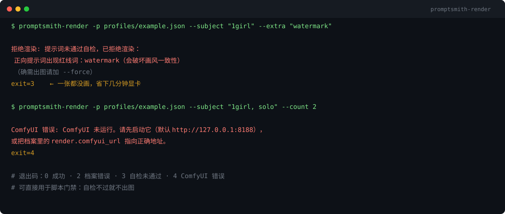

# prompt-smith-comfyui

**prompt-smith 的 ComfyUI 渲染适配器**：用档案构建提示词 → 自检 → 提交 ComfyUI → 出图 → 质量门，一条命令走完。

[](LICENSE)
[](https://github.com/zyqchanel-06/prompt-smith-comfyui/releases)
[](https://www.python.org/)




> 左边是新手常见写法（堆质量词、没结构），右边是同一条需求用档案+槽位生成的结果。
> 参数完全一致：SDXL · 832x1216 · 28 steps · cfg 6.5 · seed 20261024。

---

## 和 prompt-smith 的关系

| 包 | 职责 |
| --- | --- |
| [prompt-smith](https://github.com/zyqchanel-06/prompt-smith) | 档案 + 槽位 → 提示词 + 规则自检（零依赖，不碰显卡） |
| **prompt-smith-comfyui**（本仓库） | 把提示词送进 ComfyUI 出图，可选跑质量门 |

**分工的意义**：提示词的正确性和渲染的可用性可以分开测试。本仓库的 8 个单测全部在"提交给 ComfyUI 之前"结束——不需要真显卡就能验证工作流结构对不对。

## 安装

```bash
pip install "prompt-smith-comfyui @ git+https://github.com/zyqchanel-06/prompt-smith-comfyui.git"

# 想要出图后的亮度/对比度核对
pip install "prompt-smith-comfyui[quality] @ git+https://github.com/zyqchanel-06/prompt-smith-comfyui.git"
```

前置条件：

1. **ComfyUI 在跑**（默认 `http://127.0.0.1:8188`）
2. 档案里 `render.checkpoint` 指向你**实际存在**的模型文件名（示例里是占位符）

## 快速开始

```bash
promptsmith-render \
  --profile profiles/example.json \
  --subject "1girl, solo" \
  --scene "forest, moonlight" \
  --count 2
```

```
POSITIVE: anime style, masterpiece, best quality, ..., 1girl, solo, forest, moonlight
SAVED: 2
  out/anime-general_1.png
  out/anime-general_2.png
GATE PASS  out/anime-general_1.png  亮度=142.3 对比度=68.1
GATE FAIL  out/anime-general_2.png  亮度=198.4 对比度=41.2
注意: 1 张没过质量门，建议重出
```

### 参数

| 参数 | 默认 | 作用 |
| --- | --- | --- |
| `--profile` / `-p` | 必填 | 档案路径 |
| `--subject` 等六槽位 | 空 | 与 prompt-smith 一致；留空的用档案默认值 |
| `--count` / `-n` | 2 | 出几张 |
| `--outdir` / `-o` | `out` | 输出目录 |
| `--seed` | 随机 | 基准种子，第 i 张用 `seed+i` |
| `--prefix` | 档案名 | 文件名前缀 |
| `--force` | 关 | 自检有 error 也照常渲染 |
| `--no-gate` | 关 | 跳过亮度/对比度核对 |
| `--json` | 关 | 输出完整 JSON 报告 |

## 核心设计：自检不过就不出图

这是本适配器最重要的一条：

```
compose() → 自检 → 有 error？
                     ├─ 有 → 直接拒绝（退出码 3），一张都不画
                     └─ 无 → 提交 ComfyUI
```

为什么值得这么做：一份提示词抽 2 张图要几分钟显卡时间，而自检是毫秒级的。把"触发词写错 / 红线词混进去 / 缺必带项"这类问题挡在渲染之前，收益远大于成本。

确实想硬出（比如在调试档案）就加 `--force`。

## 工作流结构

刻意做得极简（`graph.py`）：

```
CheckpointLoaderSimple
  └─ (可选) LoraLoader
       ├─ CLIPTextEncode (positive)
       ├─ CLIPTextEncode (negative)
       └─ KSampler → VAEDecode → SaveImage
EmptyLatentImage ────────┘
```

只支持一个 checkpoint + 最多一个 LoRA。**复杂工作流请自己写**——本适配器的定位是"参数注入 + 任务轮询"，不是替你做工作流编排。

要接自定义流程，有两个办法：

```python
from promptsmith_comfyui.client import ComfyClient

client = ComfyClient("http://127.0.0.1:8188")
images = client.wait(client.queue(your_own_workflow_dict))
open("out.png", "wb").write(client.download(images[0]))
```

## 渲染参数从哪来

全部来自档案的 `render` 字段（`prompt-smith` 不解析它，原样保留给适配器）：

```json
{
  "render": {
    "comfyui_url": "http://127.0.0.1:8188",
    "checkpoint": "your_sdxl.safetensors",
    "lora": { "name": "your_style.safetensors", "strength": 0.8 },
    "width": 832, "height": 1216, "steps": 30, "cfg": 7.0,
    "sampler": "euler_ancestral", "scheduler": "normal"
  }
}
```

`lora` 也可以直接写字符串（`"your_style.safetensors"`），强度默认 1.0。

## 质量门（可选）

出图后自动调 `promptsmith.quality.gate()`，按档案里的：

```json
{ "quality_gate": { "brightness": [110, 175], "contrast_min": 60 } }
```

判断每张图是否过曝/发灰。**它只能拦明显废稿，不能判断好不好看**——判断"是不是我要的"还得靠人眼。详见核心库的 [quality-gate.md](https://github.com/zyqchanel-06/prompt-smith/blob/main/docs/quality-gate.md)。

## 退出码

| 码 | 含义 |
| --- | --- |
| 0 | 成功 |
| 2 | 档案错误 |
| 3 | 提示词没过自检（可加 `--force` 绕过） |
| 4 | ComfyUI 错误（没启动 / 执行失败 / 超时） |

可以直接用在脚本或 CI 里做批量出图门禁。

## License

MIT —— 见 [LICENSE](LICENSE)。